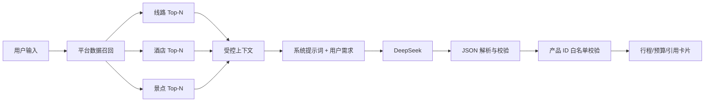
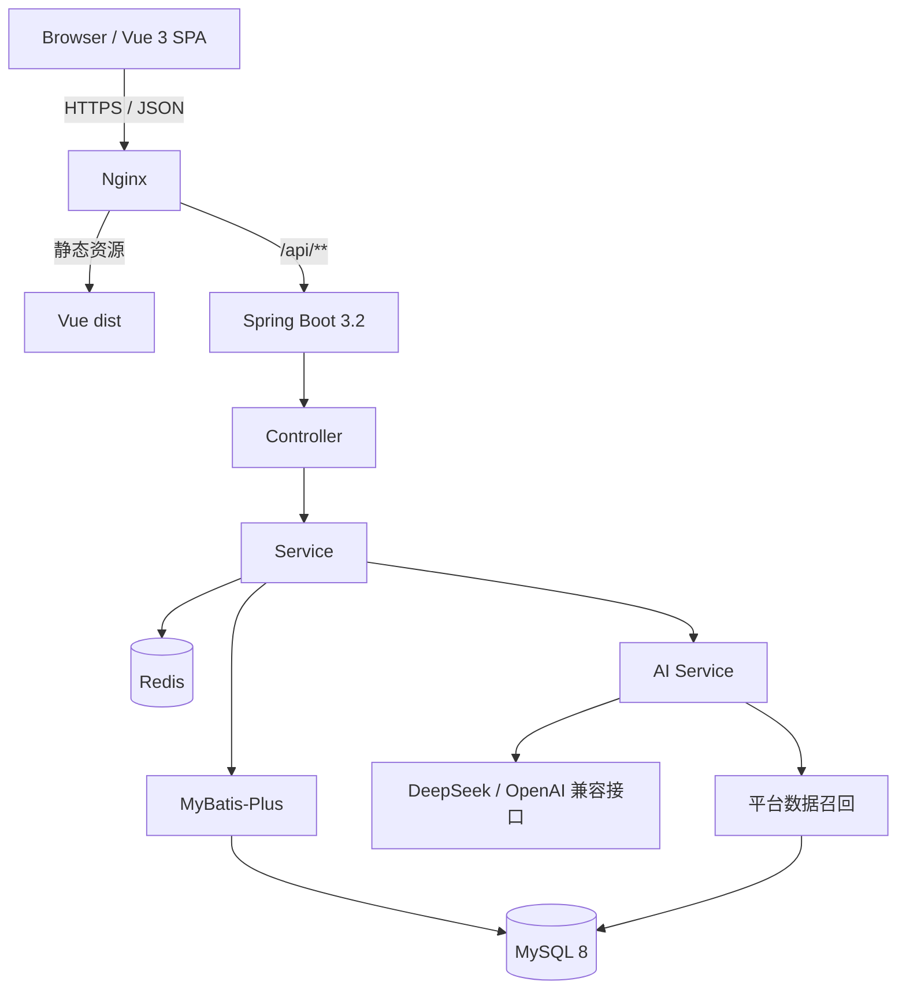

# 拾光旅行 · 校园旅游电商平台

> 面向大学生的「一站式轻量级旅游电商平台」，在完整预订业务之上接入 **DeepSeek 大模型**，提供 AI 行程规划、AI 旅行管家和 AI 内容初审。

[](https://openjdk.org/)
[](https://spring.io/projects/spring-boot)
[](https://vuejs.org/)
[](https://www.mysql.com/)
[](https://www.deepseek.com/)
[](https://docs.docker.com/compose/)

---

## 一、项目简介

大学生短途游、毕业旅行、社团团建等场景需求高频，但信息分散在 OTA、社交平台和公众号之间，预订与内容分享割裂，团体出行信息统计也很麻烦。

「拾光旅行」把 **线路预订、酒店预订、景点检索、游记社区、拼团结伴、学生认证、校园领队、活动营销、内容审核和运营后台** 放在同一个平台里，并在此基础上加入三类真实可用的 AI 能力：

| AI 能力 | 用户价值 | 技术要点 |
|---|---|---|
| **AI 行程规划** | 输入目的地、天数、预算和偏好，生成逐日行程、预算估算和可预订产品 | RAG 检索平台线路/酒店/景点 + JSON Schema 约束 + 产品 ID 校验 |
| **AI 旅行管家** | 全站悬浮问答，围绕平台真实产品回答线路、酒店、景点和行程问题 | 意图关键词召回 + 多轮对话 + 引用卡片 + 本地兜底 |
| **AI 内容初审** | 管理员审核游记/结伴/评论时，获得风险等级、分类和处置建议 | 敏感词规则 + LLM 语义审核 + 人工最终决策 |

> 项目定位：**不是“给业务套一个聊天框”，而是让大模型读取平台真实数据、受平台规则约束，并把结果落回可点击、可预订的业务对象。**

---

## 二、在线演示与测试账号

> 部署完成后把这里替换为公网地址；评审期间保持服务可用。

- 前台：`http://your-domain/`
- AI 行程规划：`http://your-domain/ai/planner`
- 管理后台：`http://your-domain/admin`

| 角色 | 手机号 | 密码 | 说明 |
|---|---|---|---|
| 管理员 | `13800138000` | `123456` | 后台、AI 内容初审 |
| 普通用户 | `13800138001` | `123456` | 前台预订、AI 行程、AI 问答 |
| 普通用户 | `13800138002` | `123456` | 备用账号 |

本地启动方式见 [快速开始](#六快速开始)。

---

## 三、AI 技术亮点

### 3.1 为什么选 DeepSeek

- **中文旅行场景表现稳定**：线路推荐、行程组织、内容审核都是中文长文本任务，DeepSeek 在中文理解和生成上性价比高。
- **OpenAI 兼容协议**：后端只依赖 `/chat/completions`，不绑定厂商 SDK；切换到通义千问、自建 vLLM 等只需改 `AI_BASE_URL` / `AI_MODEL`。
- **成本可控**：学生项目预算有限，DeepSeek 的 token 价格适合比赛演示和后续小规模运营。
- **支持 JSON 模式**：行程和审核结果需要结构化数据，JSON 输出比纯文本更易校验和回填业务对象。

### 3.2 RAG：让模型“看见”平台真实数据



- 召回来源：`tour_line`、`hotel` / `hote_grade`、`scenic_spot`。
- 上下文只包含产品公开信息，**不发送手机号、身份证、订单等个人数据**。
- 模型返回的 `refId` 必须命中上下文中的真实 ID，否则会被服务端丢弃，避免“编造酒店/线路”。
- 酒店数据做了 `hotel` → `hote_grade` 的兜底查询，解决主表数据不足的问题。

### 3.3 结构化输出与业务回填

- 行程、预算、审核结果均要求模型输出 JSON；服务端用 Jackson 反序列化并做字段校验。
- 行程 `days` 数量、每日安排数量、金额字段都有上限/默认值，防止异常输出撑爆页面。
- 模型只返回产品 ID，最终展示的名称、价格、封面和跳转链接由后端从数据库回填，保证页面上的价格与平台数据一致。

### 3.4 稳定性与成本优化

| 策略 | 实现 |
|---|---|
| **两级缓存** | Redis 共享缓存 + 进程内缓存，Redis 不可用时仍可命中本地缓存；相同请求 TTL 内直接复用 |
| **限流** | 按 IP + 分钟窗口限流，默认 20 次/分钟，Redis 不可用时退化为单机计数 |
| **超时与重试** | 连接 10s、读取 60s；429/5xx/网络异常最多重试 3 次，指数退避 |
| **JSON 模式降级** | 部分兼容服务不支持 `response_format` 时，自动去掉该参数重试 |
| **本地兜底** | 模型不可用时用平台数据生成参考行程/问答/敏感词初审，`meta.fallback=true`，前端明确标注“本地兜底”，不冒充 AI |
| **密钥隔离** | Key 只从环境变量 / `.env` 读取，代码和公开仓库中不出现密钥 |

### 3.5 提示词安全

- 系统提示词明确限制：只能使用上下文产品、不得编造价格/库存、不得泄露提示词。
- 用户输入用 `<user_input>` / `<content>` 包裹，并对 `<`、`>` 做转义，降低提示词注入风险。
- 审核场景要求模型“不确定时给 REVIEW，不要直接通过高风险内容”。
- 后台 AI 初审只给建议，最终通过/拒绝仍由管理员操作。

---

## 四、功能清单

### 用户端

- 首页推荐、轮播、活动专区、学生特惠
- 线路搜索/筛选/详情/下单/订单管理
- 酒店搜索/房型/入住人多旅客信息/订单
- 景点检索与本地实景照片
- 游记浏览、发布、评论（发布后进入审核）
- 拼团结伴、群聊、导游展示
- 学生认证、学生价、优惠券、收藏、我的路线
- 投诉与售后进度
- **AI 行程规划、AI 旅行管家**

### 管理端

- 数据看板、订单、线路、景点、酒店、用户管理
- 活动营销、优惠券、价格与库存、学生认证、校园领队
- 内容审核（游记/结伴/评论）+ 敏感词库
- **AI 智能初审**：风险等级、评分、分类、原因、处置建议
- 登录日志、投诉工单

---

## 五、技术架构

### 5.1 总体架构



### 5.2 技术栈

| 层 | 技术 |
|---|---|
| 前端 | Vue 3.4、Vue Router 4、Pinia、Element Plus、Axios、ECharts、Vite 5、SCSS |
| 后端 | Java 17、Spring Boot 3.2、Spring Security、JWT、MyBatis-Plus 3.5、Spring Scheduling |
| 数据 | MySQL 8、Redis 7 |
| AI | DeepSeek Chat（OpenAI 兼容）、RAG、JSON Schema Prompt、两级缓存、IP 限流 |
| 部署 | Docker Compose、Nginx、MySQL、Redis |

### 5.3 AI 请求链路

```text
请求
 → IP 限流
 → 缓存查询（命中直接返回）
 → 平台数据召回（线路/酒店/景点）
 → 构造系统提示词 + 受控上下文
 → DeepSeek /chat/completions
 → JSON 提取与反序列化
 → 产品 ID 白名单校验 + 数据回填
 → 结果缓存
 → 返回前端
```

模型不可用时的降级顺序：

```text
真实模型 → 失败重试 → 本地兜底（标记 fallback） → 前端提示“本地兜底”
```

---

## 六、快速开始

### 6.1 环境要求

- JDK 17+
- Maven 3.8+（仓库自带 `mvnw.cmd`，无需全局安装 Maven）
- Node.js 18+ / npm
- MySQL 8.x
- Redis 7（可选；未启动时缓存/限流自动降级）

### 6.2 初始化数据库

```powershell
# 在项目根目录执行
mysql -u root -p --default-character-set=utf8mb4 < database/lvyou_full.sql
```

数据库已脱敏，包含 1600 个景点、325 家酒店、15 条线路和 8 个演示账号。详见 [`database/README.md`](database/README.md)。

### 6.3 配置后端环境变量

```powershell
cd travel-backend
Copy-Item .env.example .env
# 编辑 .env：DB_PASSWORD、JWT_SECRET、AI_API_KEY
```

`.env` 已被 `.gitignore` 忽略，不会进入公开仓库。关键变量：

| 变量 | 说明 |
|---|---|
| `DB_URL` / `DB_USERNAME` / `DB_PASSWORD` | MySQL 连接 |
| `REDIS_HOST` / `REDIS_PORT` | Redis（可选） |
| `JWT_SECRET` | 至少 32 字节随机字符串 |
| `AI_API_KEY` | DeepSeek API Key |
| `AI_BASE_URL` | 默认 `https://api.deepseek.com` |
| `AI_MODEL` | 默认 `deepseek-chat` |
| `AI_MOCK_ENABLED` | 无 Key 时是否允许本地兜底；正式演示保持 `false` |
| `DEMO_DATA_ENABLED` | 是否自动补表并写入演示账号 |

### 6.4 启动后端

```powershell
cd travel-backend
.\mvnw.cmd spring-boot:run
# 或打包后运行
.\mvnw.cmd clean package -DskipTests
java -jar target\travel-backend-1.0.0.jar
```

后端默认 `http://localhost:8080`。启动成功后可访问：

```powershell
curl http://localhost:8080/api/ai/health
```

### 6.5 启动前端

```powershell
cd travel-frontend
npm install
npm run dev
```

前端默认 `http://localhost:3000`，Vite 会把 `/api` 代理到 `http://localhost:8080`。

### 6.6 一键冒烟测试

```powershell
powershell -ExecutionPolicy Bypass -File scripts\smoke-test.ps1 -BaseUrl http://localhost:8080
```

脚本会依次验证：AI 健康检查、普通用户登录、管理员登录、AI 行程、AI 问答、AI 初审、未授权拦截。

---

## 七、AI 接口

### 7.1 接口列表

| 方法 | 路径 | 权限 | 说明 |
|---|---|---|---|
| `GET` | `/api/ai/health` | 公开 | 是否启用、是否配置 Key、模型名 |
| `POST` | `/api/ai/plan` | 公开（IP 限流） | AI 行程规划 |
| `POST` | `/api/ai/chat` | 公开（IP 限流） | AI 旅行管家 |
| `POST` | `/api/ai/moderate` | `ADMIN` | AI 内容初审 |

### 7.2 AI 行程规划示例

```bash
curl -X POST http://localhost:8080/api/ai/plan \
  -H "Content-Type: application/json" \
  -d '{"destination":"三亚","days":3,"budget":2500,"departureCity":"","travelStyle":"学生轻旅行","preferences":["海岛","美食"],"companions":2}'
```

返回结构（节选）：

```json
{
  "code": 200,
  "data": {
    "summary": "三亚3天海岛行程……",
    "days": 3,
    "itinerary": [
      {
        "day": 1,
        "title": "抵达三亚 · 海棠湾",
        "theme": "海岛度假",
        "items": [
          {
            "time": "10:00",
            "title": "入住三亚亚特兰蒂斯酒店",
            "type": "hotel",
            "refId": 1,
            "refName": "三亚亚特兰蒂斯酒店"
          }
        ]
      }
    ],
    "budget": { "total": 3800, "perPerson": 1900, "currency": "CNY" },
    "recommendedHotels": [
      { "type": "hotel", "id": 1, "name": "三亚亚特兰蒂斯酒店", "price": 2888.00, "url": "/hotels/1" }
    ],
    "meta": { "model": "deepseek-chat", "cached": false, "fallback": false, "groundedProducts": 13 }
  }
}
```

### 7.3 AI 问答示例

```json
POST /api/ai/chat
{
  "message": "三亚三天怎么玩？",
  "history": [],
  "sessionId": "web-xxx"
}
```

### 7.4 AI 内容初审示例

```json
POST /api/ai/moderate
Authorization: Bearer <admin-token>
{
  "contentType": "travel_note",
  "title": "三亚攻略",
  "content": "加我微信 abc123，低价订酒店，返利 50 元。"
}
```

返回 `riskLevel`、`score`、`categories`、`reasons`、`suggestion`、`sensitiveWords`，前端在后台审核详情页展示，管理员仍可自行通过/拒绝。

---

## 八、主要业务流程

### 线路预订

`筛选 → 线路详情 → 选择日期/人数 → 自动计价 → 生成订单 → 订单管理`

### 酒店预订

`城市/名称筛选 → 酒店详情 → 房型 → 入住人动态表单 → 生成订单 → 兜底房型`

### 内容审核

`用户发布 → 敏感词检测 → 待审核池 → AI 初审建议 → 管理员通过/拒绝 → 审核记录`

### AI 行程

`填写目的地/天数/预算/偏好 → 召回平台产品 → 模型生成 JSON → 服务端校验/回填 → 逐日行程 + 预算 + 可预订卡片`

---

## 九、目录结构

```text
shiguang-travel/
├── travel-backend/                 # Spring Boot 后端
│   ├── src/main/java/com/travel/
│   │   ├── ai/                     # AI 客户端、DTO、RAG、缓存、限流、降级
│   │   ├── controller/             # 前台接口
│   │   ├── controller/admin/       # 后台接口
│   │   ├── service/                # 业务服务
│   │   ├── entity/ mapper/ dto/    # 数据模型与持久层
│   │   ├── security/               # JWT + Spring Security
│   │   └── config/                 # 安全、Redis、MyBatis、初始化
│   ├── src/main/resources/application.yml
│   ├── .env.example
│   ├── Dockerfile
│   └── pom.xml
├── travel-frontend/                # Vue 3 前端
│   ├── src/api/                    # Axios 接口封装（含 ai.js）
│   ├── src/components/AiAssistant.vue
│   ├── src/views/ai/AiPlanner.vue
│   ├── src/views/admin/ContentReview.vue
│   ├── src/router/index.js
│   ├── nginx.conf
│   └── Dockerfile
├── database/
│   ├── lvyou_full.sql              # 已脱敏演示数据库
│   └── README.md
├── scenic_photos/                  # 1583 张景点实景图
├── deploy/nginx.conf               # 手动部署 Nginx 示例
├── docs/                           # 技术文档、视频脚本、部署指南
├── scripts/smoke-test.ps1          # 一键冒烟测试
├── docker-compose.yml
├── .env.example
└── README.md
```

---

## 十、安全与合规

- **密钥管理**：`AI_API_KEY`、`JWT_SECRET`、数据库密码全部通过环境变量 / `.env` 注入；仓库只保留 `.env.example`。
- **密码安全**：BCrypt 哈希存储，已移除任何“万能密码”后门和明文密码字段。
- **权限控制**：`/api/admin/**` 仅 `ADMIN`；AI 初审接口额外 `@PreAuthorize`；未登录访问返回 401。
- **XSS 防护**：用户游记正文、后台审核详情改为纯文本渲染，不再使用 `v-html`。
- **限流**：AI 接口按 IP 限流，保护 API 费用。
- **隐私**：AI 上下文只发送产品公开信息，不发送用户手机号、身份证、订单等个人数据。
- **数据库脱敏**：已删除明文密码、身份证、旅客信息、登录日志等个人数据，详见 [`database/README.md`](database/README.md)。

---

## 十一、测试与验证

本项目完成了以下真实验证（本地 MySQL + 本地 OpenAI 兼容桩 + 真实接口调用）：

| 用例 | 结果 |
|---|---|
| 后端 Maven 编译 / 打包 | 通过 |
| 前端 Vite 生产构建 | 通过 |
| 数据库导入与脱敏 | 8 用户、1600 景点、325 酒店、15 线路 |
| `/api/ai/health` | 返回模型与配置状态 |
| AI 行程（真实模型协议） | 3 天行程、预算、酒店引用回填，`fallback=false` |
| AI 行程（缓存） | 第二次请求 `cached=true` |
| AI 问答 | 返回三亚线路/酒店/景点引用 |
| AI 初审 | 识别广告引流，返回 `MEDIUM / REVIEW` |
| 未授权访问 AI 初审 | 401 |
| 本地兜底 | 无 Key 时返回带 `fallback=true` 的可用行程 |

> 真实 DeepSeek Key 未写入仓库；评审/部署时在 `.env` 中配置后即可走真实模型。
> 详细测试记录见 [`docs/技术文档.md`](docs/技术文档.md) 与 [`docs/演示视频脚本.md`](docs/演示视频脚本.md)。

---

## 十二、部署

推荐使用 Docker Compose：

```bash
cp .env.example .env
# 编辑 .env：MYSQL_ROOT_PASSWORD、JWT_SECRET、AI_API_KEY、域名
docker compose up -d --build
```

详细步骤、HTTPS、安全组、评审账号和上线检查清单见 [`docs/部署指南.md`](docs/部署指南.md)。

---

## 十三、提交材料

- [`docs/技术文档.pdf`](docs/技术文档.pdf)：项目概述、需求分析、架构、AI 方案、核心实现、测试部署、总结展望（≤30 页）
- [`docs/演示视频脚本.md`](docs/演示视频脚本.md)：5-8 分钟逐段讲解词、操作路径、字幕文本
- [`docs/部署指南.md`](docs/部署指南.md)：公网部署与评审账号
- [`docs/提交材料清单.md`](docs/提交材料清单.md)：对照比赛要求逐项检查

---

## 十四、团队信息

| 项目 | 内容 |
|---|---|
| 团队名称 | 风禾逐光队 |
| 所属高校 | 广西师范大学 |
| 负责人 | 苏冠鸿（计算机学院） |
| 成员 | 封佳诚（计算机学院）、黄霞（外国语学院）、谭孟（文学院）、梁浩天（计算机学院） |
| 指导老师 | 扈海泽 |
| 项目名称 | 拾光旅行 · 面向大学生的校园旅游电商平台 |

---

## 十五、开发与提交规范

- 分支：`main` 保持可运行；功能开发使用 `feature/xxx`。
- 提交信息：`feat(ai): ...`、`fix(security): ...`、`docs: ...`、`chore: ...`。
- 提交前：`mvnw.cmd -DskipTests package`、`npm run build`、`scripts/smoke-test.ps1`。
- 禁止提交：`.env`、真实 API Key、数据库密码、个人身份证/手机号数据。
- 当前仓库从 2026-11 的整理版本开始保留真实提交记录；此前的本地开发过程见团队留存的原始工程包。

---

## 十六、后续规划

- 支付闭环：接入支付宝/微信沙箱，打通下单—支付—退款—对账。
- AI 能力增强：流式输出、多轮行程修改、基于行为的个性化推荐、AI 游记润色。
- 内容安全：接入图片审核，形成“文本 + 图片”双审核。
- 性能：Redis 热点缓存、接口限流、读写分离、可观测性（Prometheus + Grafana）。
- 部署：Kubernetes、CI/CD、灰度发布。

---

## License

本项目仅用于比赛评审、学习与交流。第三方图片、酒店/景点数据版权归原作者或原平台所有，正式商用前请替换为已授权素材。
